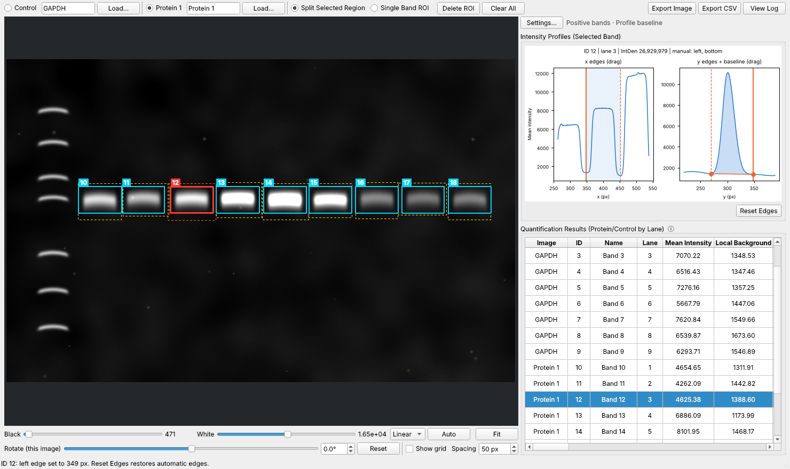

# Western Blot Band Analysis

[](https://github.com/YOUR-USERNAME/wb-band-analysis/actions/workflows/tests.yml)

A desktop application for quantifying Western blot bands. It detects bands semi-automatically, corrects each band for its local background, pairs each target band with the loading-control band in the same lane, and exports the ratios with everything needed to audit them.

It works on raw scientific images (16-bit and float TIFFs from LI-COR Odyssey, Typhoon, ChemiDoc and similar) as well as ordinary 8-bit PNG/JPEG files. Measurements always use the original pixel values; brightness and contrast settings change only the display.



## Features

- **Two images, paired by lane.** Load a loading-control image (e.g. GAPDH) and a target-protein image. Each target band is divided by the control band in the same lane. Lanes with a missing, duplicated or zero control are flagged in the table and the CSV, never silently calculated.
- **Semi-automatic detection.** Drag a box around a row of bands and the app splits it into one box per lane. It handles touching lanes and faint bands, and can leave out a marker (ladder) lane. You can also draw single boxes by hand, and move or resize any box.
- **Three background methods** (Settings):
  - **Profile baseline** (default): band edges are placed at the minima of the band's horizontal and vertical intensity profiles, and the background is a straight line between the top and bottom minima. Edges can be dragged by hand in the profile plots.
  - **Above/below**: median of thin strips just above and below the band, in the same lane.
  - **Ring**: median of a ring of pixels around the band.
- **Live intensity profiles** for the selected band, showing the measured region, the baseline and the area counted as signal.
- **Display controls** that never touch the data: black/white levels, linear or log display, auto contrast, a pixel grid, and per-image rotation to straighten a tilted blot.
- **Auditable output:** a results CSV with every band's position, background, method and pairing status; a long-format profiles CSV and a profiles PNG; an annotated image; a JSON file next to each image that restores its boxes, rotation and hand-set edges when the image is reopened; and an activity log.

Two interfaces share the same analysis code and file formats, so either can open the other's work:

| File | Interface |
|---|---|
| `wb_gui_qt.py` (launch with `run_wb_qt.py`) | PyQt6: smooth zoom and pan, movable boxes. Recommended. |
| `wb_gui.py` (launch with `run_wb.py`) | Tkinter: no extra GUI library needed. |
| `wb_analysis.py` | The analysis core: detection, background correction, profiles, pairing. No GUI code, so it can be used from scripts. |

## Installation

Requires Python 3.10 or later.

```bash
git clone https://github.com/YOUR-USERNAME/wb-band-analysis.git
cd wb-band-analysis
python -m venv .venv
source .venv/bin/activate        # Windows: .venv\Scripts\activate
pip install -r requirements.txt
```

matplotlib is optional. Without it, the app runs and still exports the profiles CSV, but shows no profile plots and writes no profiles PNG.

## Running

```bash
python run_wb_qt.py      # PyQt6 interface
python run_wb.py         # Tk interface
```

## Quick start

1. **Load the images.** Click **Load…** next to *Control* and choose the loading-control image, then do the same for *Protein 1*. The boxes beside each button set the names used in the table and CSV.
2. **Check the settings.** Click **Settings...** and set *Band Polarity*: **light** for bright bands on a dark background (fluorescence, e.g. LI-COR), **dark** for dark bands on a light background (film, chemiluminescence, colorimetric), or **auto**. Choose the background method here too.
3. **Find the bands.** With *Split Selected Region* selected, drag a box around one row of bands on each image, leaving out the ladder lane. Use *Single Band ROI* to draw individual boxes instead.
4. **Check each band.** Click a band (on the image or in the table) to see its profiles. In profile-baseline mode, drag the edge markers in the plots if an automatic edge is wrong; solid lines are set by hand, dashed lines are automatic, and **Reset Edges** reverts.
5. **Export.** **Export CSV** writes the results plus `_profiles.csv` and `_profiles.png` next to it. **Export Image** saves the active image with its boxes drawn on.

### Mouse and keyboard (PyQt6 interface)

| Action | Effect |
|---|---|
| Drag on the image | Split a region / draw a box (depending on the mode) |
| Click a box | Select it |
| Drag the selected box's edge or corner | Resize it |
| Drag inside the selected box | Move it |
| Shift + drag | Draw a new box, even starting inside the selected one |
| Right-click (or Ctrl-click) a box | Rename or delete it |
| Mouse wheel | Zoom about the pointer (**Fit** resets) |
| Middle-button drag | Pan |
| Delete / Backspace | Delete the selected box |
| Ctrl+O / Ctrl+S (Cmd on macOS) | Open an image / export the CSV |

## Output files

| File | Contents |
|---|---|
| `<name>.csv` | One row per lane: target and control densities, ratio, pairing status, band positions, backgrounds, background method, polarity, rotation, and (profile mode) the measured region, baseline and edge source. |
| `<name>_profiles.csv` | Every band's horizontal and vertical mean-intensity profile, one row per point (long format, ready for pandas, R or Prism). |
| `<name>_profiles.png` | Plots of all profiles. |
| `<image>.rois.json` | Saved automatically next to each image: boxes, rotation, hand-set edges and a checksum of the image file. Restored when the image is reopened. If the image file has changed since, the app asks before loading them; a file that can't be used is kept, renamed `.bak`, rather than overwritten. |
| `wb_analysis_log.txt` | Activity log (files opened, ROI files, rotations, edge edits, exports), next to the scripts or in `~/WB_Analysis/`. Also viewable with **View Log**. |

## Validation and tests

`tests/data/make_blot.py` generates synthetic blots where the true amount of protein in every band is known exactly: nine sample lanes with uneven loading and true target fold changes of 1.0, 2.0 and 0.5, plus a ladder, uneven background, dust and camera noise. `tests/data/make_varbg.py` adds mild, moderate and severe variable backgrounds for stress-testing background correction. Both use fixed random seeds, so they produce identical images on every machine.

```bash
python tests/test_analysis.py   # analysis core: ratios within 5% of the truth for all three background methods
python tests/test_qt_app.py     # PyQt6 app driven by real mouse events (detection, editing, edges, rotation, exports)
```

`test_qt_app.py` saves screenshots to `tests/out/`. To run it without a display (e.g. over SSH), set `QT_QPA_PLATFORM=offscreen` first.

Both tests run automatically on GitHub Actions for every push: the analysis test on Linux, Windows and macOS (Python 3.10 and 3.13), and the GUI test on Linux. Screenshots from each GUI run can be downloaded from the run's page under *Artifacts*.

## Citing

If you use this software in published work, please cite it. GitHub's **Cite this repository** button (from `CITATION.cff`) gives the reference in APA and BibTeX.

## Licence

GNU General Public License v3.0 or later; see [LICENSE](LICENSE). The PyQt6 interface requires a GPL-compatible licence.
